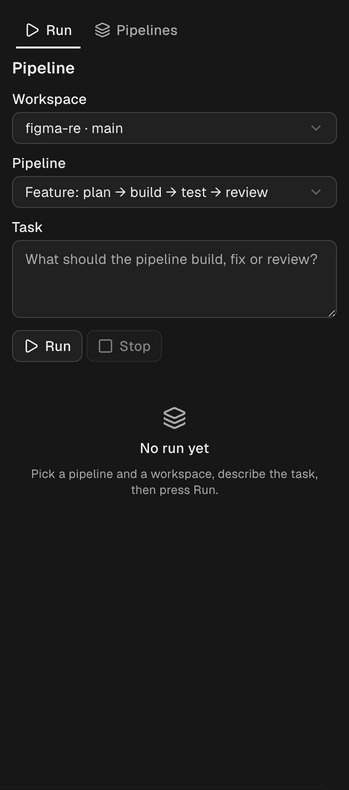

# Pipeline for Orca

Staged workflows for coding agents, inside [Orca](https://github.com/stablyai/orca): plan, build,
test and review chained in **one agent session**, so each stage sees everything the stages before
it did.



Orca already runs one prompt at a time. This plugin adds the pipeline around it — a fixed order of
stages, each with its own prompt, driven by the agent's own completion signal.

```
 Plan ──▶ Build ──▶ Test ──▶ Review
   │        │        │        │
   └────────┴────────┴────────┴──▶ same terminal, same conversation
```

It is inspired by [Worca](https://worca.dev), which runs a deterministic plan → implement → review
pipeline on top of Claude Code as its own engine. This takes the same idea and makes it native to
Orca: no second runtime, no npm package, and the work lands in your worktree, your terminals and
your review flow.

## Flows

| Pipeline | Stages | What it is for |
| --- | --- | --- |
| **Feature** | plan → build → test → review | A change from scratch: plan first, keep the diff small, verify it, then review your own work as a strict reviewer. |
| **QA (e2e)** | scope → cases → environment → run → report | End-to-end QA of a feature or branch: bring the app up, click through the journeys in Orca's embedded browser, and end with a pass/fail table and a verdict. |
| **Bug fix** | reproduce → fix → prove | Root cause before code: reproduce it, fix the cause, prove the fix holds. |

Every flow is just prompts — edit them in the panel, or add your own.

## From a prompt or a phone

Orca Mobile has no plugin panels, so the panel is desktop-only. The same flows therefore also ship
as an agent skill, which any prompt can start — including a phone **Quick Command**:

```sh
mkdir -p ~/.agents/skills/orca-pipeline
cp skills/orca-pipeline/SKILL.md ~/.agents/skills/orca-pipeline/SKILL.md
```

Orca's agents pick the skill up on their next session. Then, from anywhere:

- **Desktop or chat** — *"Use the orca-pipeline skill: run e2e QA on this worktree."*
- **Phone** — Settings → Quick Commands → **Agent Prompt**, with the same sentence. The agent runs
  scope → cases → environment → run → report on the paired desktop, marks each stage, and writes
  `qa-report.md`, so the phone gets a notification and a file to read instead of a terminal to
  babysit.
- **A scheduled run** — *"Start the QA automation for this repo"*, or `orca automations run <id>`.

The skill drives the stages itself, so it has no stage table and no *Carry on* button; the panel
keeps the gates. Use the panel when you want to intervene between stages, the skill when all you
have is a prompt.

## What it does

- **Runs a pipeline in a workspace.** Pick a worktree or folder, pick a pipeline, describe the
  task, press Run. The first stage launches the agent; every later stage types its prompt into the
  same terminal, so the agent keeps its context.
- **Moves on when a stage is done.** The plugin listens for `agent.status.changed`: when the agent
  finishes its turn, the next stage starts. No polling, no waiting on the person.
- **Stops when you are needed.** A blocked agent pauses the run and notifies you. Press *Carry on*
  after you answer it in the terminal; *Retry stage* and *Skip stage* are there when a stage goes
  wrong.
- **Shows where you are.** Stage table with live timings, the tail of the terminal when a stage
  ends, and a status bar item with `2/4 · running`.
- **Edits pipelines in the panel.** Name, agent and stages per pipeline; `{{task}}` in a prompt is
  replaced by the task you typed.

Those three ship on first run and are yours to edit. A pipeline you delete stays deleted; a new
default added by a later version is appended once, without touching the ones you changed.

The **QA (e2e)** flow assumes the agent can drive the app the way a person does: it opens Orca's
embedded browser (`orca tab create`, `snapshot`, `click`, `fill`), reads what is on screen, and
closes its tabs at the end. That is what makes the report evidence rather than opinion.

## Requirements

- Orca `>= 1.4.248` (components panels, status bar items).
- One of the agents Orca can launch (`claude`, `codex`, `cursor`, `grok`, `omp`, `pi`).

## Install

From the plugin folder:

```sh
orca plugin install /path/to/orca-pipeline
```

From GitHub, once published:

```sh
orca plugin install <owner>/orca-pipeline
```

Orca asks you to approve what it grants before anything runs. For development, load the folder
instead:

```sh
orca plugin dev watch .   # loads it, streams logs and reloads; Ctrl-C unloads
```

## Permissions

The plugin is a trusted worker: it runs in its own Node process with your account's access. It
asks for exactly what a pipeline needs — `workspace:read`, `agent:read`, `agent:launch`,
`terminal:send`, `terminal:read`, `notifications:show`, `storage:own`, `settings:own` — and
nothing else. It has no network access of its own and keeps its data in Orca's plugin storage.

## Inspired by Worca

[Worca](https://worca.dev) is a deterministic multi-agent pipeline for AI coding agents: you
describe the work, it plans, implements and reviews, and you end up with a reviewed pull request.
The idea is worth copying, and the shape of it — an ordered set of stages, each one ending in
something you can check — is what this plugin implements.

What differs is where it runs:

| | Worca | Pipeline (this plugin) |
| --- | --- | --- |
| Engine | its own app: web UI, CLI and a Claude Code skill (`npm i -g @worca/app`) | Orca itself: `agent.launch`, `terminal.sendText`, `agent.status.changed` |
| Agent | Claude Code, Copilot or a local model | whichever agent you already launch in Orca |
| Pipeline | fixed stages, chosen by Worca | prompts you can read and edit in the panel |
| Version control | its own worktrees and PR flow | the worktree you picked, your Source Control panel |

If you want Worca itself, run it — it works fine in an Orca terminal. This is for when you want the
pipeline without the second runtime.

## How it works

- `src/worker.ts` owns the run state machine. A stage starts (`agent.launch` for the first one,
  `terminal.sendText` after that), and `agent.status.changed` for that terminal ends it. The run
  lives in `orca.storage`, so a worker reload does not lose it — a run interrupted by a restart
  comes back paused.
- `src/panel.tsx` is a components panel: it renders Orca's own controls and talks to the worker
  through `plugin.request` / `orca.panels.post`.
- `src/protocol.ts` declares both directions once, so panel and worker are typed end to end.

## Development

```sh
orca plugin validate .      # manifest and layout
orca plugin check .         # renders each panel scenario with the worker
orca plugin test .          # runs the tests in Node
npx tsc -p .                # type-checks against Orca's typings
```

There is no build step: Orca transpiles the `.ts`/`.tsx` sources when it loads them.

## License

MIT
